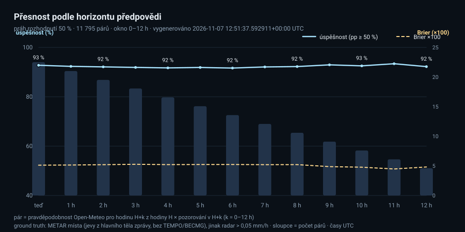
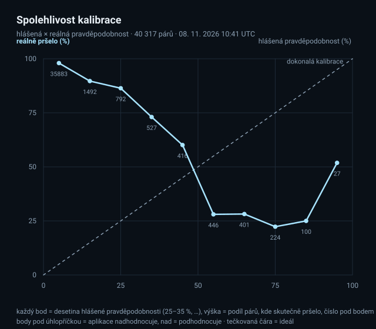
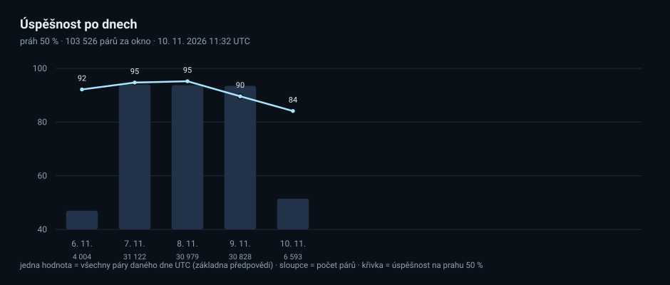
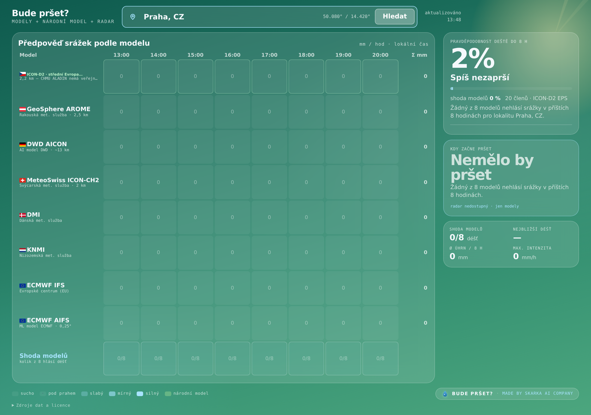
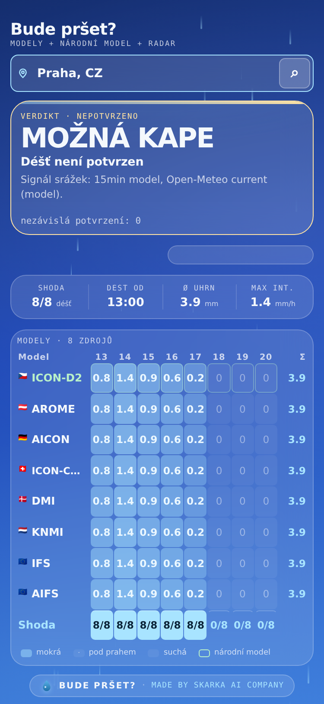
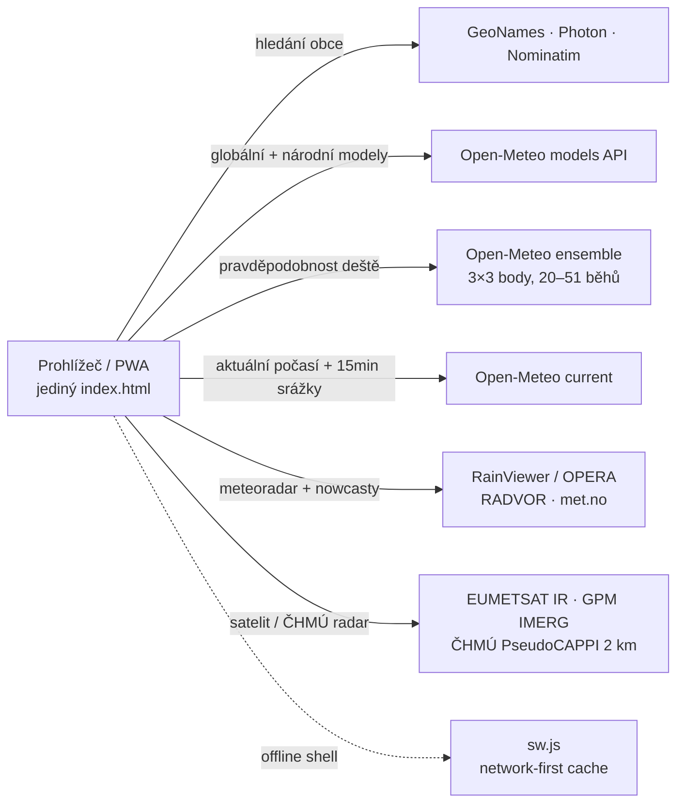

# Bude pršet? 🌧️

**[▶ Otevřít aplikaci](https://daviscoder123.github.io/bude_prset/)** &nbsp;·&nbsp; [▶ Testy](https://github.com/daviscoder123/bude_prset/actions/workflows/tests.yml) &nbsp;·&nbsp; [▶ Dashboard sběrače dat](https://bude-prset-proxy.kopaci-podstavec1q.workers.dev/analysis)


Jednoobrazovková webová aplikace pro rychlou odpověď na jedinou otázku: **bude v příštích 8 hodinách pršet?** A pokud ano — tak **kdy přesně začne**.

Srovnává hodinové předpovědi srážek ze špičkových globálních modelů (ECMWF, NOAA GFS, DWD ICON, Météo-France, UK Met Office, GEM, JMA), automaticky přidává **národní/regionální model** podle vybrané země (pro Česko ALADIN ČHMÚ) a na pozadí čte **meteoradar** (globální kompozit RainViewer / OPERA) přímo v místě obce, ze kterého zpřesňuje minutový odhad začátku deště. Celý výsledek se vejde na jednu obrazovku — bez scrollování, bez klikání.

## 📊 Živá měření přesnosti

Tato čísla nejsou marketingový údaj. Sběrač dat (viz [Edge proxy a sběrač dat](#️-edge-proxy-a-sběrač-dat-kola-8ac8ag)) každých 5 minut ukládá předpovědi i pozorování (METAR stanic, radar) pro 100 evropských obcí; denní workflow z nich přepočítá grafy níže a commite je zpět do repozitáře — **README tedy vždy ukazuje aktuálně naměřenou přesnost**. Metodika ( párování, ground truth, metriky): [docs/architektura.md, §8](docs/architektura.md).

<p align="center">
  <br>
  <em>Úspěšnost rozhodnutí (práh 50 %) a Brierovo skóre podle horizontu 0–12 h. Sloupce = počet párů.</em>
</p>

| Kalibrace pravděpodobností | Denní trend |
| :---: | :---: |
|  |  |
| <em>Hlášená × reálná pravděpodobnost — body pod úhlopříčkou = nadhodnocování.</em> | <em>Jeden den UTC = všechny páry se základem v daném dni.</em> |

## 📸 Screenshoty

*Snímky negeneruje člověk ručně — CI workflow spustí aplikaci s ukázkovými daty a vyfotí ji (viz sekce [Generování screenshotů](#-generování-screenshotů)), takže vždy odpovídají aktuálnímu vzhledu.*

| Déšť na cestě (desktop) | Sucho (desktop) |
| :---: | :---: |
|  |  |

<p align="center">
  <br>
  <em>Mobilní zobrazení: zjednodušený jednořádkový přehled</em>
</p>

## ✨ Co aplikace umí

- 🔍 **vyhledávání obcí a adres po celém světě** (GeoNames + OpenStreetMap, záložní Photon a Nominatim), fixace aktuální GPS polohy jedním klikem
- 🌐 **matice model × hodina** s hodinovou intenzitou srážek v mm/h — globální modely s vlajkami zdrojových zemí (vestavěné SVG, nezávislé na fontu systému)
- 🇨🇿 **národní/regionální model vždy první v tabulce** s badgem **NÁRODNÍ** (pro Česko ALADIN ČHMÚ), nad ním radarové pozorování, pokud je dostupné
- 📊 **řádek konsenzu** — mírně barevně odlišený od ostatních modelů, s celkovou pravděpodobností deště z ensemble runů
- 🕐 **„Kdy začne pršet"** — minutový odhad začátku (i konce) deště kombinující radar, nowcasty a konsenzus modelů, včetně intervalu nejistoty
- ❄️ **sníh jako občan první třídy** — pokud modely (nebo radar/METAR) hlásí sníh, celý verdikt se přepne na sněhový: „Sněžení do / Sníh od", intenzita v cm/h, úhrn „napadne ~X cm" i sněhová čára (z výšky nulové izotermy)
- 📈 **pravděpodobnost s kalibrací** — procenta z ensemble (NEP přes 3×3 body ~±11 km) ohýbaná k realitě vlastními Brierovými měřeními; aplikace rozlišuje „v obci" a „někde do ~11 km"
- 🧠 **učení z vlastních měření** — váhy zdrojů blendu, bias modelů a kalibrace procent se učí z METAR pozorování per uživatel, bez serveru
- 🎨 **sklo design** — průsvitné panely nad živým gradientem pozadí, který mění barvu podle stavu počasí: modrofialová = prší, fialovo-oranžová = blíží se, petrolejovo-zelená = sucho
- ♻️ **automatická aktualizace každých 15 minut, pouze když je aplikace viditelná** (na pozadí nulová aktivita — šetří baterii i mobilní data)
- 📱 **PWA**: lze přidat na plochu telefonu, funguje i bez připojení (cache statického shellu), bez webfontů
- 🔒 **bez API klíčů, bez sledování, bez reklam** — v produkci pořád jediný statický `index.html` (generovaný, viz [Vývoj a testy](#️-vývoj-a-testy))

## 🧠 Jak aplikace funguje

Kompletní výklad rozhodovací pipeline (blend osy, prahy, pravděpodobnosti, učení, sběrač, metodika měření) je v dokumentu **[docs/architektura.md](docs/architektura.md)**. Shrnutí:



- **Prahy:** o „dešti" se mluví od **0,2 mm/h**; v tropech a při konvekci (CAPE) se práh zvyšuje až na 1,0 mm/h, protože modely rozmazávají skvrnitý konvektivní déšť do velkých ploch slabého mrholení. Pozorování (METAR, radar) se vždy posuzují nad základním prahem.
- **Čas příchodu:** blend osy — vlastní advekce radaru, cizí nowcasty (RainViewer, RADVOR, met.no), 15min nowcast Open-Meteo, hodinový konsenzus modelů a ensemble jako statistika času; z odhadů vychází vážený medián + interval nejistoty.
- **Pravděpodobnost:** ensemble NEP přes 3×3 body, Brierovou kalibrací per zdroj; verdikt drží ensemble a špičky Open-Meteo přebírá jen na polovinu cesty (kolo 8z3: falešné poplachy 30 → 11 z 726 párů).
- **Učení:** váhy zdrojů blendu (per země × horizont × režim), bias modelů per lokalita a kalibrace procent — vše z vlastních ověřených měření, s pojistkami proti extrémům, aby málo dat nic nepokazilo.

### Matice modelů — pravidla zobrazení

1. **Radarové pozorování** (ČHMÚ radar, pokud je pro lokalitu dostupné) stojí vždy první — je to jediné skutečné pozorování, ne předpověď, proto má i zvláštní barvu.
2. **Národní/regionální model** hned za ním, označený badgem **NÁRODNÍ** — pro Česko ALADIN ČHMÚ. Má zpravidla nejvyšší rozlišení pro dané území.
3. **Globální modely** s vlajkami zdrojových zemí: ECMWF IFS 🇪🇺, NOAA GFS 🇺🇸, DWD ICON 🇩🇪, Météo-France 🇫🇷, UK Met Office 🇬🇧, GEM 🇨🇦, JMA 🇯🇵.
4. **Konsenzus** jako poslední řádek — souhrn všech modelů, mírně odlišený pozadím, aby se dal na první pohled vyčlenit.
5. Intenzity se zobrazují jako mm/h s čísly zarovnanými tabulkovými číslicemi a **vždy s úvodní nulou** (0.9, nikdy .9). Buňky nepřetékají; plně vyplněné (a proto světlé) buňky přepínají na tmavý text, aby zůstaly čitelné.

### Časy a původ aktuálních dat

Hodinové časy se z Open-Meteo načítají jako Unix timestampy a interně zůstávají v UTC. Tabulka, začátek a konec deště používají časové pásmo vybrané lokality včetně změn letního času; údaj „u tebe" zobrazuje tentýž okamžik v pásmu zařízení.

Open-Meteo `current` a 15minutové řady jsou modelová data, nikoli další nezávislá pozorování. Do potvrzení aktuálního deště ani do intenzity označené jako ověřená se nezapočítávají jako měření; `current.precipitation` se převádí z mm za `current.interval` sekund na mm/h. Chybějící nebo neplatné jednotky či interval znamenají neznámou intenzitu, ne nulu. Viz [dokumentace Open-Meteo](https://open-meteo.com/en/docs).

Při každém načtení lokality se předchozí stav odstraní. Nová předpověď a doplňkové zdroje mohou měnit výsledek jen v aktuální generaci požadavků; načítání ani výpadek nesmí zobrazit data jiné lokality.

### Provoz na pozadí — service worker

`sw.js` cachuje pouze statický shell (HTML, manifest, ikony), aby šla appka přidat na plochu a startovala rychle. Strategie je network-first: při každém startu online se stáhne čerstvá verze a cache se použije jen jako záloha při výpadku spojení. API požadavky (předpovědi, radar, geokódování) jdou vždy přímo na síť a necachují se zde — o úsporu dat se stará krátkodobá in-memory cache v aplikaci. Na pozadí SW nic nestahuje.

## 🛰️ Zdroje dat

- předpovědi, ensemble a geokódování: [open-meteo.com](https://open-meteo.com) (CC BY 4.0)
- záložní geokódování: [Photon](https://photon.komoot.io) a [OpenStreetMap Nominatim](https://nominatim.org)
- radar: [RainViewer](https://www.rainviewer.com/api.html)
- ČHMÚ radarové snímky a národní nowcasty (DWD RADVOR, KNMI, met.no)
- satelit IR: [EUMETSAT](https://view.eumetsat.int) · srážky mimo dosah radarů: [GPM IMERG (NASA GIBS)](https://worldview.earthdata.nasa.gov)
- blesky: [Blitzortung](https://www.blitzortung.org) (WebSocket zrcadla)
- pozorování pro měření přesnosti: METAR ([aviationweather.gov](https://www.aviationweather.gov))
- reverzní geokódování polohy: [BigDataCloud](https://www.bigdatacloud.com)

## 📁 Struktura repozitáře

```text
bude_prset/
├── index.html              # build artifact — Pages ho servíruje (negenerovat ručně!)
├── index.template.html      # HTML + CSS část šablony
├── src/main.js             # celá aplikace (JS) — zdroj pravdy
├── sw.js                   # service worker (offline shell, network-first)
├── manifest.webmanifest    # PWA manifest + ikony
├── tools/build.cjs         # skládá template + main.js -> index.html
├── tests/                  # jednotkové, prohlížečové i worker testy (66+ testů)
├── scripts/
│   ├── screenshots.cjs      # deterministické snímky pro README (Playwright)
│   └── accuracy_charts.py   # živé grafy přesnosti z dat sběrače (SVG, bez závislostí)
├── worker/                 # edge proxy + sběrač (Cloudflare Workers, KV)
├── docs/
│   ├── architektura.md     # kompletní výklad pipeline, prahů, učení, metodiky
│   ├── CHANGELOG.md        # historie vývoje („kola" 2–8z3)
│   ├── screenshots/        # automaticky generované snímky (CI)
│   └── graphics/           # automaticky generované grafy přesnosti + stats.json
└── .github/workflows/      # testy, deploy, screenshoty, grafy přesnosti
```

## 🚀 Nasazení na GitHub Pages

1. Vytvoř nový veřejný repozitář (např. `bude-prset`).
2. Nahraj do něj všechny soubory z této složky (`index.html`, `index.template.html`, `src/`, `tools/`, `manifest.webmanifest`, `sw.js`, `icon-192.png`, `icon-512.png`, `README.md`, `tests/`, `scripts/`, `.github/`).
3. V repozitáři otevři **Settings → Pages**, v sekci *Build and deployment* zvol **Deploy from a branch**, větev `main` a složku `/ (root)`. Ulož.
4. Za chvíli poběží aplikace na `https://TVOJE-JMENO.github.io/bude-prset/`.

## 📱 Přidání na plochu telefonu

- **Android (Chrome):** otevři adresu aplikace → menu ⋮ → **Přidat na plochu** (nebo *Instalovat aplikaci*).
- **iPhone (Safari):** otevři adresu → tlačítko sdílení → **Přidat na plochu**.

## 🛠️ Vývoj a testy

Aplikace stále běží jako statický HTML soubor, bez runtime npm závislostí. Od kola 8ab se ale `index.html` **negeneruje ručně**: zdrojem pravdy je `src/main.js` (JavaScript aplikace) a `index.template.html` (HTML + CSS). Skript `npm run build` (`tools/build.cjs`) je složí zpět do jednoho `index.html` — deterministicky a bez závislostí. Commitnutý `index.html` je build artifact (Pages ho servíruje přímo) a CI hlídá, že nezevstal: po každém pushu znovu sestaví a selže, pokud neodpovídá commitnuté verzi.

```sh
npm ci
npm run build           # složí index.template.html + src/main.js -> index.html
npm test                # jednotkové testy — funkce vytažené přímo z index.html
npx playwright install --with-deps chromium
npm run test:browser     # end-to-end v řízeném prohlížeči
```

Úprava kódu aplikace tedy vždy probíhá tak: uprav `src/main.js` → `npm run build` → commitni **oba** soubory (`src/main.js` i `index.html`) najednou.

- **Jednotkové testy** (`tests/regression.test.cjs`) používají přímo funkce ze zdrojového HTML a ověřují časová pásma, přechody letního času, jednotky srážek, reset stavu a rozdíl mezi modely a pozorováním.
- **Prohlížečové testy** (`tests/browser.test.cjs`) spouštějí lokální server, používají řízené API odpovědi a kontrolují hledání, geolokaci, mobilní zobrazení, opožděné odpovědi, selhání i záložní modely; neověřují dlouhodobou meteorologickou přesnost ani dostupnost externích služeb.
- **Testy Workera** (`tests/worker.test.cjs`, součást `npm test`) pokrývají edge proxy i sběrač včetně METAR parseru (regrese: jevy z trendových skupin TEMPO/BECMG se nesmí počítat jako aktuální déšť).

CI (`.github/workflows/tests.yml`) spouští obě sady na každý pull request a push do `main`.

## ☁️ Edge proxy a sběrač dat (kola 8ac–8ag)

Aplikace směruje hlavní předpověď a ensemble přes **edge proxy na Cloudflare Workers** (zdarma): jeden dotaz na uživatele místo série, cache sdílená napříč všemi uživateli, retry a 503 logika na jednom místě. Worker je transparentní passthrough se whitelistou parametrů a validací — žádná agregace, žádné API klíče.

Ten samý Worker zároveň **sbírá historii**: cron každých 5 minut projde 100 evropských obcí (12 dílků/hod, round-robin), uloží předpovědi Open-Meteo (včetně pravděpodobností), ensemble, radar RainViewer (PNG dekód přímo ve Workeru, medián mm/h z 3×3 pixelů) a METAR stanic do KV (`raw/YYYYMMDDHH:mm`, TTL 14 dní). Z těchto dat vychází grafy přesnosti v sekci [Živá měření](#-živá-měření-přesnosti) i zpětné testy změn pravidel (kolo 8z3).

- Dashboard sběrače: [`/analysis`](https://bude-prset-proxy.kopaci-podstavec1q.workers.dev/analysis) · export hodiny: `/analysis/page?h=YYYYMMDDHH` · stav: `/analysis/status`
- Podrobnosti, testy i postup nasazení: [`worker/README.md`](worker/README.md)

Proxy je **zapnutá** (`BP_PROXY` v `src/main.js`); při jejím výpadku klient automaticky spadne na přímé volání Open-Meteo (nouzové cesty jsou vždy přímé).

## 🖼️ Generování screenshotů

Snímky v sekci [Screenshoty](#-screenshoty) negeneruje člověk ručně. Workflow **Screenshots** (`.github/workflows/screenshots.yml`) spustí aplikaci v CI s deterministickými ukázkovými daty — jednou scénář „déšť", jednou „sucho" — a přes Playwright vyfotí desktopové i mobilní zobrazení. Výsledné PNG se commitnou do `docs/screenshots/`, takže je vidí každý, kdo si prohlédne README bez spouštění aplikace. Při každé změně `index.html` se snímky samy přegenerují — dokumentace nikdy „neleží" o vzhledu aplikace.

## 📈 Generování grafů přesnosti

Grafy v sekci [Živá měření přesnosti](#-živá-měření-přesnosti) přepočítává workflow **Grafy přesnosti** (`.github/workflows/graphics.yml`) denně (a při změně skriptu). Skript `scripts/accuracy_charts.py` je čistý Python bez závislostí: stáhne okno dat sběrače, vytvoří páry „předpověď × pozorování" (ground truth: METAR s opraveným parserem, jinak radar), vykreslí tmavé SVG v motivu aplikace a zapíše `stats.json` — z něj živý badge přesnosti v záhlaví. Worker nedostupný nebo prázdná data job nezabije; grafy zůstávají z posledního úspěšného běhu.

## 📜 Historie vývoje

Jednotlivá „kola" vylepšení od experimentů z července 2026 přes mobilní redesign až po měření přesnosti shrnuje [docs/CHANGELOG.md](docs/CHANGELOG.md); technický výklad pipeline v [docs/architektura.md](docs/architektura.md).
