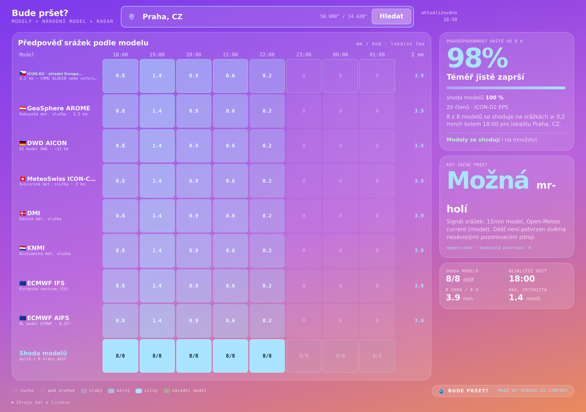
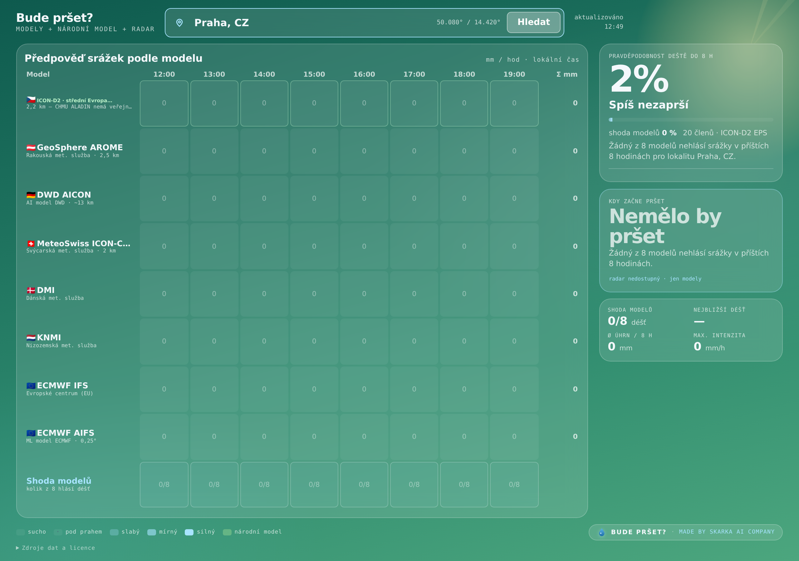
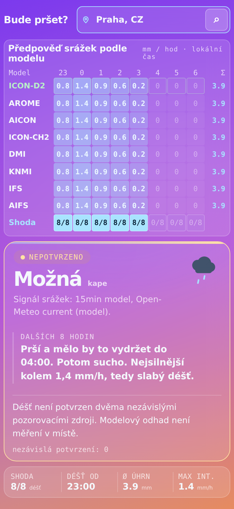
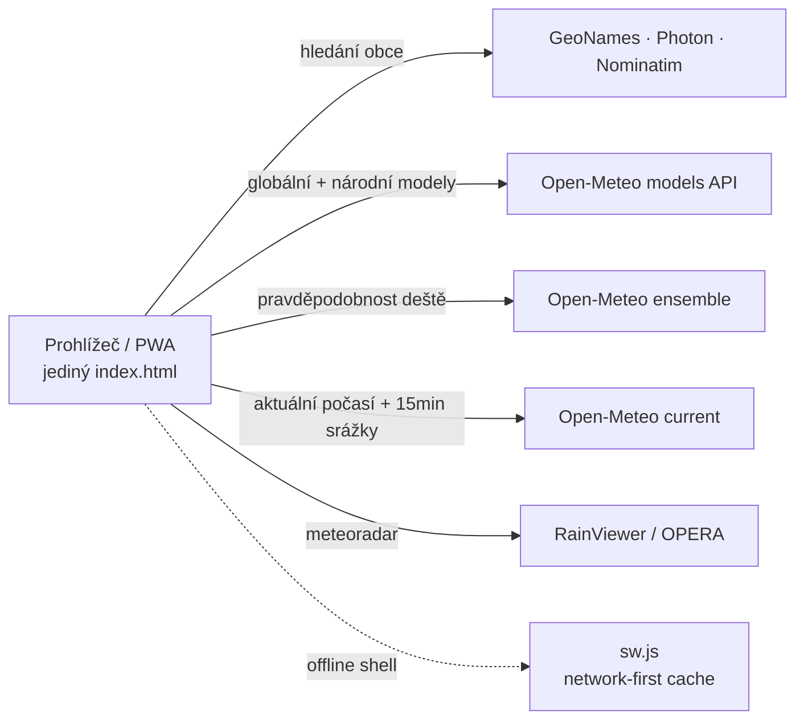

# Bude pršet? 🌧️

**[▶ Otevřít aplikaci](https://daviscoder123.github.io/bude_prset/)** &nbsp;·&nbsp; [▶ Testy](https://github.com/daviscoder123/bude_prset/actions/workflows/tests.yml)


Jednoobrazovková webová aplikace pro rychlou odpověď na jedinou otázku: **bude v příštích 8 hodinách pršet?** A pokud ano — tak **kdy přesně začne**.

Srovnává hodinové předpovědi srážek ze špičkových globálních modelů (ECMWF, NOAA GFS, DWD ICON, Météo-France, UK Met Office, GEM, JMA), automaticky přidává **národní/regionální model** podle vybrané země (pro Česko ALADIN ČHMÚ) a na pozadí čte **meteoradar** (globální kompozit RainViewer / OPERA) přímo v místě obce, ze kterého zpřesňuje minutový odhad začátku deště. Celý výsledek se vejde na jednu obrazovku — bez scrollování, bez klikání.

## 📸 Screenshoty

*Snímky negeneruje člověk ručně — CI workflow spustí aplikaci s ukázkovými daty a vyfotí ji (viz sekce [Generování screenshotů](#-generování-screenshotů)), takže vždy odpovídají aktuálnímu vzhledu.*

| Déšť na cestě (desktop) | Sucho (desktop) |
| :---: | :---: |
|  |  |

<p align="center">
  <br>
  <em>Mobilní zobrazení: zjednodušený jednořádkový přehled</em>
</p>

## ✨ Co aplikace umí

- 🔍 **vyhledávání obcí a adres po celém světě** (GeoNames + OpenStreetMap, záložní Photon a Nominatim), fixace aktuální GPS polohy jedním klikem
- 🌐 **matice model × hodina** s hodinovou intenzitou srážek v mm/h — globální modely s vlajkami zdrojových zemí
- 🇨🇿 **národní/regionální model vždy první v tabulce** s badgem **NÁRODNÍ** (pro Česko ALADIN ČHMÚ), nad ním radarové pozorování, pokud je dostupné
- 📊 **řádek konsenzu** — mírně barevně odlišený od ostatních modelů, s celkovou pravděpodobností deště z ensemble runů
- 🕐 **„Kdy začne pršet"** — minutový odhad začátku (i konce) deště kombinující radar a konsenzus modelů
- 🎨 **Sklo design** — průsvitné panely nad živým gradientem pozadí, který mění barvu podle stavu počasí: modrofialová = prší, fialovo-oranžová = blíží se, petrolejovo-zelená = sucho
- ♻️ **automatická aktualizace každých 15 minut, pouze když je aplikace viditelná** (na pozadí nulová aktivita — šetří baterii i mobilní data)
- 📱 **PWA**: lze přidat na plochu telefonu, funguje i bez připojení (cache statického shellu), bez webfontů
- 🔒 **bez API klíčů, bez sledování, bez reklam** — a bez buildu: celá aplikace je jediný statický `index.html`

## 🧠 Jak aplikace funguje



### Matice modelů — pravidla zobrazení

1. **Radarové pozorování** (ČHMÚ radar, pokud je pro lokalitu dostupné) stojí vždy první — je to jediné skutečné pozorování, ne předpověď, proto má i zvláštní barvu.
2. **Národní/regionální model** hned za ním, označený badgem **NÁRODNÍ** — pro Česko ALADIN ČHMÚ. Má zpravidla nejvyšší rozlišení pro dané území.
3. **Globální modely** s vlajkami zdrojových zemí: ECMWF IFS 🇪🇺, NOAA GFS 🇺🇸, DWD ICON 🇩🇪, Météo-France 🇫🇷, UK Met Office 🇬🇧, GEM 🇨🇦, JMA 🇯🇵.
4. **Konsenzus** jako poslední řádek — souhrn všech modelů, mírně odlišený pozadím, aby se dal na první pohled vyčlenit.
5. Intenzity se zobrazují jako mm/h s čísly zarovnanými tabulkovými číslicemi a **vždy s úvodní nulou** (0.9, nikdy .9). Buňky nepřetékají; plně vyplněné (a proto světlé) buňky přepínají na tmavý text, aby zůstaly čitelné.

### Časy a původ aktuálních dat

Hodinové časy se z Open-Meteo načítají jako Unix timestampy a interně zůstávají v UTC. Tabulka, začátek a konec deště používají časové pásmo vybrané lokality včetně změn letního času; údaj „u tebe" zobrazuje tentýž okamžik v pásmu zařízení.

Open-Meteo `current` a 15minutové řady jsou modelová data, nikoli další nezávislá pozorování. Do potvrzení aktuálního deště ani do intenzity označené jako ověřená se nezapočítávají jako měření; `current.precipitation` se převádí z mm za `current.interval` sekund na mm/h. Chybějící nebo neplatné jednotky či interval znamenají neznámou intenzitu, ne nulu. Viz [dokumentace Open-Meteo](https://open-meteo.com/en/docs).

Při každém načtení lokality se předchozí stav odstraní. Nová předpověď a doplňkové zdroje mohou měnit výsledek jen v aktuální generaci požadavků; načítání ani výpadek nesmí zobrazit data jiné lokality.

### Provoz na pozadí — service worker

`sw.js` cachuje pouze statický shell (HTML, manifest, ikony), aby šla appka přidat na plochu a startovala rychle. Strategie je network-first: při každém startu online se stáhne čerstvá verze a cache se použije jen jako záloha při výpadku spojení. API požadavky (předpovědi, radar, geokódování) jdou vždy přímo na síť a necachují se zde — o úsporu dat se stará krátkodobá in-memory cache v aplikaci. Na pozadí SW nic nestahuje.

## 🛰️ Zdroje dat

- předpovědi a geokódování: [open-meteo.com](https://open-meteo.com) (CC BY 4.0)
- záložní geokódování: [Photon](https://photon.komoot.io) a [OpenStreetMap Nominatim](https://nominatim.org)
- radar: [RainViewer](https://www.rainviewer.com/api.html)
- reverzní geokódování polohy: [BigDataCloud](https://www.bigdatacloud.com)

## 🚀 Nasazení na GitHub Pages

1. Vytvoř nový veřejný repozitář (např. `bude-prset`).
2. Nahraj do něj všechny soubory z této složky (`index.html`, `manifest.webmanifest`, `sw.js`, `icon-192.png`, `icon-512.png`, `README.md`, `tests/`, `scripts/`, `.github/`).
3. V repozitáři otevři **Settings → Pages**, v sekci *Build and deployment* zvol **Deploy from a branch**, větev `main` a složku `/ (root)`. Ulož.
4. Za chvíli poběží aplikace na `https://TVOJE-JMENO.github.io/bude-prset/`.

## 📱 Přidání na plochu telefonu

- **Android (Chrome):** otevři adresu aplikace → menu ⋮ → **Přidat na plochu** (nebo *Instalovat aplikaci*).
- **iPhone (Safari):** otevři adresu → tlačítko sdílení → **Přidat na plochu**.

## 🛠️ Vývoj a testy

Aplikace stále běží jako statický HTML soubor, bez sestavení a bez runtime npm závislostí. Node.js 20+ slouží pouze pro testy:

```sh
npm ci
npm test                 # jednotkové testy — funkce vytažené přímo ze zdrojového HTML
npx playwright install --with-deps chromium
npm run test:browser     # end-to-end v řízeném prohlížeči
```

- **Jednotkové testy** (`tests/regression.test.cjs`) používají přímo funkce ze zdrojového HTML a ověřují časová pásma, přechody letního času, jednotky srážek, reset stavu a rozdíl mezi modely a pozorováním.
- **Prohlížečové testy** (`tests/browser.test.cjs`) spouštějí lokální server, používají řízené API odpovědi a kontrolují hledání, geolokaci, mobilní zobrazení, opožděné odpovědi, selhání i záložní modely; neověřují dlouhodobou meteorologickou přesnost ani dostupnost externích služeb.

CI (`.github/workflows/tests.yml`) spouští obě sady na každý pull request a push do `main`.

## 🖼️ Generování screenshotů

Snímky v sekci [Screenshoty](#-screenshoty) negeneruje člověk ručně. Workflow **Screenshots** (`.github/workflows/screenshots.yml`) spustí aplikaci v CI s deterministickými ukázkovými daty — jednou scénář „déšť", jednou „sucho" — a přes Playwright vyfotí desktopové i mobilní zobrazení. Výsledné PNG se commitnou do `docs/screenshots/`, takže je vidí každý, kdo si prohlédne README bez spouštění aplikace. Při každé změně `index.html` se snímky samy přegenerují — dokumentace nikdy „neleží" o vzhledu aplikace.
