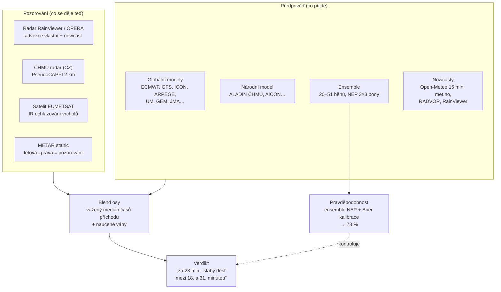
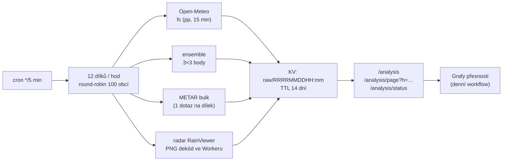

# Architektura — jak vzniká verdikt „Bude pršet"

Tento dokument popisuje, **jak aplikace počítá**, ne jak vypadá. Pro rychlý přehled
stačí [README](../README.md); zde je kompletní výklad rozhodovací pipeline, prahů,
pravděpodobností, učení z vlastních měření, sběrače dat i měření přesnosti.

Obsah:

1. [Velký obraz](#1-velký-obraz)
2. [Zdroje dat](#2-zdroje-dat)
3. [Práh srážek — kdy se řekne „prší"](#3-práh-srážek--kdy-se-řekne-prší)
4. [Verdikt „Kdy začne pršet" — blend osy](#4-verdikt-kdy-zacne-prset--blend-osy)
5. [Pravděpodobnosti](#5-pravděpodobnosti)
6. [Učení z vlastních měření](#6-učení-z-vlastních-měření)
7. [Sběrač dat (Worker)](#7-sběrač-dat-worker)
8. [Měření přesnosti a grafika](#8-měření-přesnosti-a-grafika)

---

## 1. Velký obraz

Aplikace je jedna obrazovka a jedna otázka: *v příštích 8 hodinách zaprší?*
Odpověď se skládá ze tří vrstev, které se navzájem kontrolují:

Zásada, která se táhne celým kódem: **nic se netvrdí z jednoho zdroje**. Radar
potvrdí déšť sám, jen je-li echo vydatné a čerstvé přímo nad obcí; stanice
potvrdí déšť sama do 25 km, jinak až se souhlasem modelu; pravděpodobnosti se
kalibrují proti METAR pozorováním, která si aplikace ověří sama.

## 2. Zdroje dat

| Zdroj | Co dává | K čemu se používá |
| :--- | :--- | :--- |
| Open-Meteo `models` API | hodinové srážky v mm/h ze ~17 globálních modelů | matice model × hodina, konsenzus, blend |
| Národní/regionální model | nejvyšší rozlišení pro dané území (ALADIN ČHMÚ pro CZ) | první řádek tabulky, hlas blendu |
| Open-Meteo ensemble | 20–51 běhů téhož modelu s rozhozeným startem, 3×3 body ~±11 km | pravděpodobnost (NEP), čas příchodu, šance do N minut |
| Open-Meteo `current` + `minutely_15` | aktuální modelové počasí, 15minové srážky | nowcast do 60 min (POZOR: model, ne pozorování) |
| RainViewer / OPERA | globální meteoradar, 10-min snímky | advekce pole, radarový kompas, „prší teď" |
| ČHMÚ radar | PseudoCAPPI 2 km, 1×1 km, snímek každých 5 min | nezávislé potvrzení, hlas do blendu |
| DWD RADVOR, KNMI, met.no | národní radarové nowcasty | nejhustší extrapolace srážek |
| EUMETSAT GIBS (IR) | satelitní infračervené kanály | ochlazování vrcholů mraků = konvekce dřív než radar |
| GPM IMERG | satelitní srážky | kompas mimo dosah radarů |
| METAR (aviationweather) | oficiální pozorování stanic | ground truth pro učení i měření přesnosti |
| GeoNames / Photon / Nominatim, BigDataCloud | geokódování, reverzní poloha | vyhledávání obcí |

Veškeré API jsou veřejné a bez klíčů. Hlavní objemy (předpovědi, ensemble) jdou
přes edge proxy na Cloudflare Workers — jeden dotaz na uživatele místo série,
cache sdílená všemi uživateli ([`worker/README.md`](../worker/README.md)).

## 3. Práh srážek — kdy se řekne „prší"

Všechny rozhodnutí pracují s **prahem intenzity**, ne s binárním „ano/ne" z
modelu. Práh není konstanta, ale funkce dvou vlivů (`threshFor`):

- **Zeměpisná šířka:** v tropech (do ~15°) je práh **1,0 mm/h**, v mírném pásu
  (od ~25°) **0,2 mm/h**, mezi nimi lineární interpolace. Důvod: globální modely
  rozmazávají konvekci do velkých ploch slabého deště — bez tropického prahu by
  aplikace v Jakartě hlásila déšť prakticky neustále.
- **Konvekce (CAPE):** mezi 400 a 2000 J/kg se práh zvyšuje od základní hodnoty
  k tropické. Konvektivní déšť je skvrnitý — model, který takový režim hlásí,
  právem vyžaduje silnější signál, aby se hlásil slabý mrholení.
- Výsledný práh je **maximum** obou vlivů, se stropem 1,0 mm/h.

Dva prahy se zásadně netykají: `THRESH_OBS` (0,2 mm/h) — pozorování se nikdy
nepřepne na zvýšený práh, protože METAR a radar nepodléhají modelovému rozmazání;
`THRESH_END` (0,12 mm/h) — konec deště se pozná i při doznívajícím mrholení.

## 4. Verdikt „Kdy začne pršet" — blend osy

Čas příchodu deště nespočítá jeden model — spočítá ho **blend pozorovacích
extrapolací a modelů** (`buildBlendTimeline`). Každý zdroj nabízí svůj odhad
„déšť dorazí za X minut" a vstupuje s váhou, která exponenciálně klesá s
horizontem: pozorování vládnou první hodinu, modely přebírají slovo dál.

| Zdroj blendu | Váha v čase t (minuty dopředu) | Proč zrovna tak |
| :--- | :--- | :--- |
| vlastní advekce z radarových dlaždic | `e^(−t/40)` | čerstvé pole nad obcí je nejpřesnější, ale rychle stárne |
| nowcast RainViewer | `0,85·e^(−t/55)` | cizí optical flow, o krok méně jistý než vlastní čtení |
| národní nowcast (RADVOR, KNMI) | `0,90·e^(−t/85)` | 5min snímky, kalibrace na srážkoměry — drží nejdéle |
| met.no nowcast | `0,80·e^(−t/70)` | radarový, mm/h přímo |
| regionální nowcast | `0,55·e^(−t/90)` | asimiluje radar i stanice, vidí i vznikající buňky |
| Open-Meteo 15 min nowcast | doplněk do 1 | zbytek po pozorovacích zdrojích |
| hodinový konsenzus modelů | `min(0,35; t/60·0,35)` | modelům se věří pomalu rostoucí váhou |
| **ensemble (čas příchodu)** | `0,35·e^(−t/150)` | 20–51 běhů = nejhustší statistika *času*, ne intenzity |

Z odhadů se váhy vynásobí, spočítá **vážený medián** = hlášený čas příchodu.
Rozptyl mezi zdroji dá interval „mezi N. a M. minutou" — nepřesnost se nepřehazuje
pod koberec, zobrazuje se.

**Kontrolní hlasy pozorování:**

- Radar potvrdí déšť sám (čerstvé, vydatné echo přímo nad obcí) — jinak v suchu
  hlásí snížení, i když modely prší.
- ČHMÚ hlasuje svým PseudoCAPPI: souhlasí-li snímek s odhadem (déšť nyní ±5 min,
  nebo první echo ±30 min od predikce), blend se přitáhne k němu.
- Satelit: výrazné ochlazování vrcholů (K/min) je znak konvekce dřív, než ji
  radar uvidí — důvěryhodný satelit dostává hlas v blendu.
- Stanice potvrdí déšť sama do 25 km, jinak až se souhlasem modelu.
- Prší-li, verdikt se přepne z „Déšť od" na „Déšť do" s odhadem konce
  (práhu konce 0,12 mm/h).

**Konvektivní prior:** v režimu přeháněk (konvektivní zlomek > 0,5) extrapolace
radar buňky, které teprve vzniknou, nevidí — dokud učení nemá vlastní vzorky,
váhy pozorovacích zdrojů klesnou (radar ×0,70, nowcasty ×0,80–0,90) a modely se
posílí (×1,5). Jakmile se pro daný zdroj a režim nahromadí vlastní měření, prior
ustupuje a přebírají naučené křivky.

## 5. Pravděpodobnosti

Aplikace nikdy neukáže „50 %" bez rozmyslu — rozlišuje, **čí** procento to je:

- **Hlavní číslo (hero %):** ensemble NEP — podíl členů, které v některém bodě 3×3
  mřížky (~±11 km) vyprší nad prahem. Kalibruje se Brierovou křivkou per zdroj
  (viz §6), výsledek se ořízne do 2–98 %. Bez ensemblu se místo pravděpodobnosti
  zobrazí „shoda modelů" — a jasně to říká: podíl modelů není pravděpodobnost.
- **Pravděpodobnost verdiktu:** `verdictProb` — ensemble je podkladem a
  Open-Meteo ho **nikdy nesníží**; hlásí-li OM více, jde verdikt jen na
  **polovinu cesty** k němu: `max(ens; (ens+om)/2)` (kolo 8z3: na 726 oknových
  párech falešné poplachy 30→11, úspěšnost 91,3→92,6 %, Brier 0,0593→0,0579).
  Bez obou zdrojů zůstane škála podle počtu souhlasících modelů (2 zdroje = 0,7,
  ani ne „skoro jistě").
- **„Šance do N minut":** procento členů ensemblu, jejichž čas začátku spadá do
  hlášeného rozpětí — vztahuje se k tomu, co věta slibuje, ne k celému oknu.
- **„V obci vs. někde do ~11 km":** při konvekci rozdíl desítky procent bodů
  (přeháňka nemusí trefit bod) — při rozdílu ≥ 10 p.b. se ukazují obě čísla.

## 6. Učení z vlastních měření

Aplikace se učí ze skutečných pozorování (METAR, radar) třemi
nezávislými mechanismy, vše v localStorage/IndexedDB uživatele:

1. **Brierova fronta a kalibrace procent.** Každý vyslovený verdikt jde do fronty
   se zdrojem (ensemble / Open-Meteo / shoda); po `BRIER_MIN_BIN` ověřených
   vzorcích v binu se z křivky „hlášené % → reálně %" stává kalibrace, která
   ohýbá zobrazovaná procenta k realitě. Do fronty jde **surový** prediktor —
   kalibrace se nesmí učit na vlastním výstupu.
2. **Naučené váhy blendu.** Pro každou zemi, horizont (30/45/60 min), zdroj a
   režim (frontální × konvektivní) se vede EMA log-poměru „co zdroj tvrdil /
   co METAR změřil". Nadhodnocující zdroj slábne, podhodnocující sílí; při
   málo vzorcích se vliv smrští k nule (`n/(n+15)`) a extrémy drží clamp
   ⟨0,5; 1,5⟩. Řídké používání aplikace tedy nic nepokazí.
3. **Bias modelů per lokalita.** Poslední log-poměry každého modelu pro dané
   místo (max 40 míst) korigují zobrazované intenzity.

## 7. Sběrač dat (Worker)

Bez sběru historie nelze měřit ani učit. Worker na Cloudflare proto sbírá data
pro **100 evropských obcí** každých 5 minut:

- **Klíč** `raw/YYYYMMDDHH:mm`, TTL 14 dní — plné okno pro zpětná testování.
- **METAR:** hromadný dotaz na celý dílek (1 subrequest), zpráva se parsuje
  včetně pravidla z opravy #23 — jevy z trendových skupin TEMPO/BECMG (předpověď
  vývoje, ne pozorování) se do aktuálního počasí nezapočítávají.
- **Radar:** PNG dlaždice se dekóduje přímo ve Workeru (bez canvasu), medián
  mm/h z 3×3 pixelů kolem obce = druhý svědek ground truth tam, kde METAR chybí.
- Endpointy `/analysis` (dashboard), `/analysis/page?h=YYYYMMDDHH` (export
  celé hodiny), `/analysis/status` (aktuálnost).

Podrobnosti nasazení a testy: [`worker/README.md`](../worker/README.md).

## 8. Měření přesnosti a grafika

Skript [`scripts/accuracy_charts.py`](../scripts/accuracy_charts.py) stahuje
sběračem nashromážděná data, skládá **páry** „předpověď × pozorování" a kreslí
grafy do `docs/graphics/`:

- **pár** = pravděpodobnost Open-Meteo pro hodinu H+k z hodiny H proti
  pozorování v hodině H+k, k = 0…12;
- **ground truth** = METAR místa (jevy z hlavního těla zprávy, vždy s pravidlem
  #23 — parser se spouští znovu na raw text, takže starší záznamy z doby před
  opravou se hodnotí korektně), chybí-li METAR, radar > 0,05 mm/h;
- **metriky:** úspěšnost na prahu 50 % a Brierovo skóre, celkem i podle
  horizontu, desetin pravděpodobnosti a dnů.

Workflow **Grafy přesnosti** (`.github/workflows/graphics.yml`) běží denně,
grafy a badge `stats.json` commituje do main — README tedy vždy ukazuje
aktuální naměřenou přesnost, ne marketingový údaj. Worker nedostupný nebo data
prázdná nezakládají issue: grafy zůstávají z posledního úspěšného běhu.

---

Historii jednotlivých „kol" vylepšení shrnuje [CHANGELOG](CHANGELOG.md).
